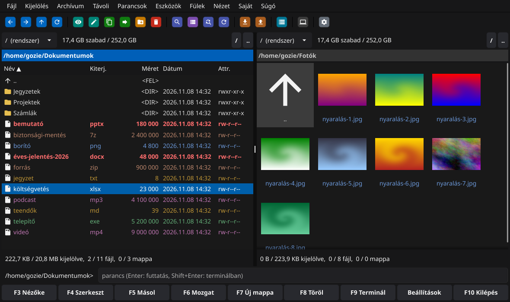
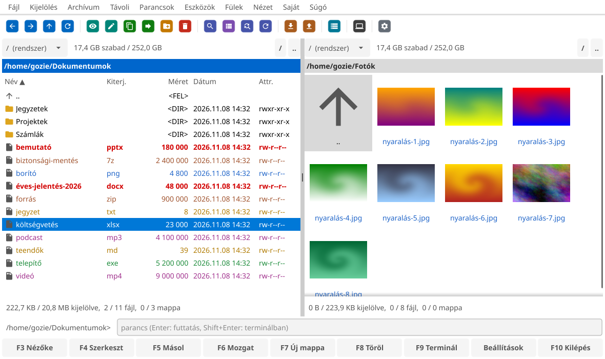
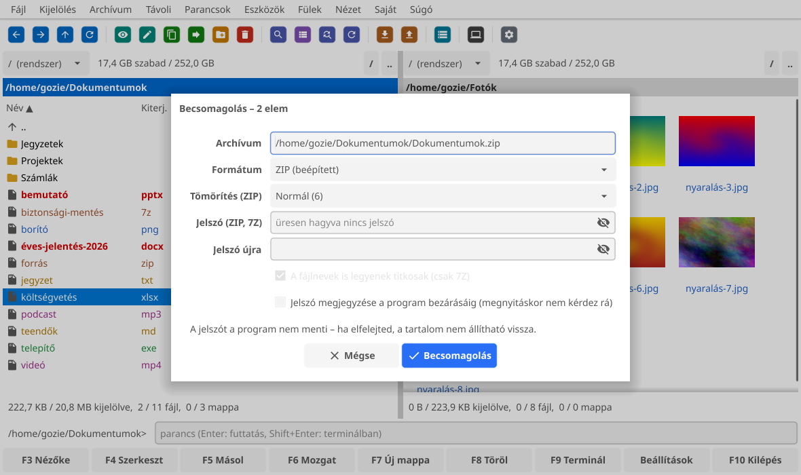

<div align="center">

# Gozie Commander

**Gyors, billentyűzetről is kényelmes kétpaneles fájlkezelő Windowsra és Linuxra**<br>
*A fast, keyboard-friendly two-panel file manager for Windows and Linux*

[](https://github.com/gozie-lab/GozieCmd/releases/latest)
[](LICENSE)


[](#készítés)

[**Magyarul**](#magyarul) · [**English**](#english) · [**⬇ Letöltés / Download**](https://github.com/gozie-lab/GozieCmd/releases/latest)



</div>

---

## Magyarul

A Gozie Commander a klasszikus kétpaneles fájlkezelők nyomdokain jár: két mappa egymás mellett, a
műveletek egy-egy billentyűre (F5 másol, F6 mozgat, F8 töröl…), és minden, ami a mindennapi
fájlkezeléshez kell – archívumok, FTP és SFTP, összehasonlítás, tömeges átnevezés – egyetlen,
telepítés nélkül is futó programban. Ugyanaz a program Windowson és Linuxon, közös beállításokkal.

### ✨ Amit tud

<table>
<tr><td valign="top" width="50%">

**📁 Fájlkezelés**
- Két panel, panelenként **lapfülek** (indításkor visszaállnak)
- Másolás, mozgatás, törlés **háttérben, sorba állítva** – a futó másolás is háttérbe küldhető
- Felülírásnál érthető kérdés (*mindet / egyiket sem / kihagyás*)
- Törlés a **Lomtárba / Kukába**, vagy véglegesen
- **Többfájl-átnevező**: név- és kiterjesztés-maszk, számláló, dátum, keresés–csere (regex is), előnézet, **visszavonás**
- Mappák **összehasonlítása** és **szinkronizálása**
- **Húzd és ejtsd** a panelek és más programok között
- **Kedvenc mappák**, előzmények, parancssor és terminál a mappában

</td><td valign="top">

**🔎 Keresés és nézetek**
- **Fájlkeresés** név, tartalom, méret és dátum szerint (UTF-16 szövegben is)
- **Gyorskeresés** gépeléssel – ékezet nélkül is talál („szamla” → *Számla.pdf*)
- Részletes, rövid és **bélyegképes** nézet
- **Gyorsnézet** a másik panelen, beépített nézőke (szöveg, Markdown, kép, hexa)
- **Változásfigyelés**: a lista magától frissül, ha más program módosít
- A bedugott **pendrive** azonnal megjelenik (Linuxon a nem csatoltat is csatolja)

</td></tr>
<tr><td valign="top">

**🗜️ Archívumok**
- ZIP, 7Z, RAR, TAR, TAR.GZ / XZ / BZ2, GZ – **mappaként böngészhetők**
- Másolás be és ki, törlés és új mappa ZIP-en, TAR-on belül
- **Jelszavas archívumok** megnyitása (ZIP, 7Z, RAR) és **létrehozása** (ZIP AES-256-tal, 7Z a fájlnevek titkosításával is)
- A 7Z íráshoz a [7-Zip](https://www.7-zip.org/) programot használja, ha telepítve van

</td><td valign="top">

**🌐 Távoli helyek**
- **FTP, SFTP** (SSH-kulcs, gépkulcs-ellenőrzés), **WebDAV**, **SMB**
- Mentett kapcsolatok – **jelszót sosem ment**
- „Kapcsolat bontása” gomb, tétlenség esetén magától bont
- Windowson a hálózati gépek és megosztások böngészése

</td></tr>
<tr><td valign="top">

**🧰 Eszközök**
- Fájlok **összehasonlítása tartalom szerint**, színezett eltérésekkel
- **Ellenőrzőösszegek** (MD5, SHA-1, SHA-256) készítése és ellenőrzése
- **Ismétlődő fájlok** keresése
- Nagy fájlok **darabolása és összefűzése**
- Attribútumok, jogok és dátumok módosítása

</td><td valign="top">

**🎨 Testreszabás**
- **Világos, sötét vagy automatikus téma** – követi a Windows váltását
- Színek, betűk, **fájltípusonkénti színezés**
- Szerkeszthető **eszköztár** külső programokkal, saját ikonnal
- **Saját billentyűparancsok** és **saját menü**
- **Hordozható mód**, a beállítások menthetők és Windows ↔ Linux között átvihetők
- Magyar és angol felület, további nyelvek fordítási sablonnal

</td></tr>
</table>

<div align="center">


</div>

### ⬇ Letöltés és telepítés

A legújabb változat mindig a **[Releases](https://github.com/gozie-lab/GozieCmd/releases/latest)** oldalon van.

| | |
|---|---|
| **Windows 10 / 11** | Töltsd le a `GozieCmd-…-windows.zip` fájlt, csomagold ki egy mappába, és indítsd a **`GozieCmd.exe`**-t. Telepíteni nem kell. |
| **Linux (x86_64)** | Töltsd le a `GozieCmd-…-linux-x86_64.tar.gz` fájlt, bontsd ki, és futtasd a **`telepit.sh`**-t: a program bekerül az alkalmazások menüjébe. Eltávolítás: `eltavolit.sh`. |
| **Linux – Flatpak** | Töltsd le a `GozieCmd-…-x86_64.flatpak` fájlt, és nyisd meg (a Szoftverközpont / Discover telepíti), vagy terminálban: `flatpak install --user GozieCmd-…-x86_64.flatpak`. A 7-Zip benne van, a beállítások közösek a kicsomagolt változattal. |

**Frissítés:** a program naponta egyszer magától megnézi, van-e új verzió, és jóváhagyás után
letölti, ellenőrzi és lecseréli magát (kézzel: *Súgó › Frissítés keresése…*). A beállítások megmaradnak.

### ⌨️ A legfontosabb billentyűk

| Billentyű | Művelet | Billentyű | Művelet |
|---|---|---|---|
| `Tab` | panelváltás | `F3` / `F4` | nézőke / szerkesztés |
| `Enter` / `Backspace` | be a mappába / vissza | `F5` / `F6` | másolás / mozgatás |
| `Insert`, `Szóköz` | jelölés | `Shift+F6` | átnevezés |
| `Num +` / `Num −` | jelölés mintával | `F7` | új mappa |
| `Ctrl+T` / `Ctrl+W` | új fül / fül bezárása | `F8` | törlés (Lomtárba) |
| `Ctrl+D` | kedvenc mappák | `Ctrl+M` | többfájl-átnevező |
| `Ctrl+Q` | gyorsnézet | `Alt+F5` / `Alt+F9` | be- / kicsomagolás |
| `Alt+F7` | fájlkeresés | `F9` | terminál |

A teljes lista a programban: `F1` (*Súgó › Billentyűparancsok*). Minden billentyű átállítható a Beállításokban.

### 🔒 Adatvédelem

A program semmilyen adatot nem küld sehova. Az egyetlen hálózati kérés a frissítés keresése
(ez kikapcsolható). Jelszót – sem FTP-, SFTP-, sem archívumjelszót – **nem ment**; az archívum jelszavát
legfeljebb a program bezárásáig jegyzi meg, ha kéred.

---

## English

> **🇬🇧 Switching to English:** the program starts in Hungarian. Click **Beállítások** (bottom-right button,
> or menu **Nézet › Beállítások…**), stay on the first tab (**Kezelés**), choose **English** under
> **Nyelv / Language**, press **OK** and **restart** the program. Every window – including file dialogs
> and confirmations – will then be in English.

Gozie Commander follows the tradition of classic two-panel file managers: two folders side by side,
one key per action (F5 copy, F6 move, F8 delete…), and everything you need for daily file work –
archives, FTP and SFTP, comparison, batch renaming – in a single program that runs without installation.
The same program runs on Windows and Linux with the same settings.

### ✨ Features

- **Files** – two panels with **tabs**; copy, move, delete **in the background, queued** (a running copy can be sent to the background too); clear overwrite prompts; delete to **Recycle Bin / Trash**; **multi-rename** with masks, counters, dates, search & replace (regex), preview and **undo**; **compare** and **synchronize** folders; **drag & drop**; favourite folders, history, command line and terminal.
- **Search & views** – **find files** by name, content, size and date; **quick search** by typing (accent-insensitive); detailed, brief and **thumbnail** views; **quick view** panel and a built-in viewer (text, Markdown, images, hex); **live folder watching**; USB drives appear instantly (on Linux unmounted drives are mounted on selection).
- **Archives** – ZIP, 7Z, RAR, TAR, TAR.GZ/XZ/BZ2, GZ **browsable like folders**; copy in and out; **password-protected archives**: open and **create** ZIP (AES-256) and 7Z (with encrypted file names), open RAR. Writing 7Z uses [7-Zip](https://www.7-zip.org/) when installed.
- **Remote** – **FTP, SFTP** (SSH keys, host key verification), **WebDAV**, **SMB**; saved connections **never store passwords**; disconnect button and automatic disconnect when idle.
- **Tools** – content **diff** with highlighted changes; **checksums** (MD5, SHA-1, SHA-256); **duplicate finder**; **split and join** large files; change attributes, permissions and dates.
- **Customization** – **light, dark or automatic theme** (follows Windows); colours, fonts, **per-type file colours**; editable **toolbar** with external programs and their icons; **custom key bindings** and **user menu**; **portable mode**; settings can be exported and moved between Windows and Linux; Hungarian and English UI, more languages via a translation template.

### ⬇ Download & install

Get the latest version from **[Releases](https://github.com/gozie-lab/GozieCmd/releases/latest)**.

- **Windows 10 / 11:** download `GozieCmd-…-windows.zip`, extract it and run **`GozieCmd.exe`** – no installation needed.
- **Linux (x86_64):** download `GozieCmd-…-linux-x86_64.tar.gz`, extract it and run **`telepit.sh`** to add it to your application menu (`eltavolit.sh` removes it).
- **Linux – Flatpak:** download `GozieCmd-…-x86_64.flatpak` and open it (GNOME Software / Discover installs it), or run `flatpak install --user GozieCmd-…-x86_64.flatpak`. 7-Zip is included; settings are shared with the extracted version.

**Updates:** once a day the program checks for a new version and, after you confirm, downloads, verifies
and replaces itself (manually: *Help › Check for updates…*). Your settings are kept.

### 🔒 Privacy

The program sends no data anywhere; the only network request is the update check (can be switched off).
Passwords – FTP, SFTP or archive – are **never saved**.

---

## 🛠️ Fordítás forrásból / Building from source

Go 1.24 kell; a Linux-változathoz OpenGL- és X11-fejlécek is (Ubuntun: `libgl1-mesa-dev xorg-dev`).
Requires Go 1.24; the Linux build also needs OpenGL/X11 headers.

```sh
sh build.sh      # GozieCmd.exe + goziecmd
sh package.sh    # kiadási csomagok / release packages
go test ./...
```

Új kiadás / new release: `git tag v0.52 && git push --tags` – a GitHub Actions lefordítja és feltölti
a csomagokat (a címkének egyeznie kell a `version.go` verziószámával).

A kiadás neve „Gozie Commander X.YY”, a leírása a `VALTOZASOK.md` megfelelő szakaszából készül – új kiadás előtt oda kell írni az újdonságokat. / The release is named “Gozie Commander X.YY”; its notes come from the matching section of `VALTOZASOK.md`.

## Készítés

<a name="készítés"></a>A Gozie Commandert **Gozie** ([gozie-lab](https://github.com/gozie-lab)) tervezte,
irányította és tesztelte; a programkód az [Anthropic](https://www.anthropic.com/) **Claude** nevű
mesterséges intelligenciájával közös munkában készült.
*Designed, directed and tested by Gozie; the code was written together with Claude, Anthropic's AI assistant.*

## Licenc / License

**GPL-3.0-or-later** – lásd / see [LICENSE](LICENSE). A felhasznált könyvtárak licencei / third-party
licenses: [THIRD_PARTY_LICENSES.txt](THIRD_PARTY_LICENSES.txt).

A Gozie Commander független projekt, más fájlkezelőkhöz nincs köze.
Gozie Commander is an independent project, not affiliated with any other file manager.

### Flatpak

A `flatpak/hu.gozie.commander.yml` leírás alapján a GitHub Actions minden kiadásnál elkészíti a
`.flatpak` csomagot. Helyben / locally:

```sh
go mod vendor
flatpak-builder --user --install --force-clean build flatpak/hu.gozie.commander.yml
flatpak run hu.gozie.commander
```
